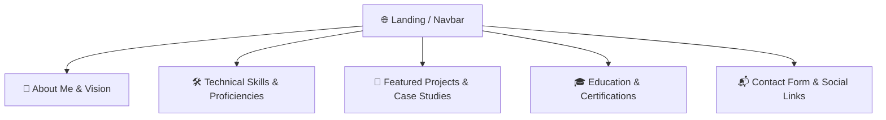

<div align="center">

# 🌐 Developer Portfolio Website — Momin Rifat

[](https://developer.mozilla.org/en-US/docs/Web/HTML)
[](https://developer.mozilla.org/en-US/docs/Web/CSS)
[](https://developer.mozilla.org/en-US/docs/Web/JavaScript)
[](#)
[](#)

<p align="center">
  <b>A modern, responsive, and visually aesthetic personal portfolio website designed to showcase projects, skills, certifications, and academic achievements.</b>
</p>

---

</div>

## 📌 Features & Highlights

- **Hero & Bio Section**: Interactive introduction with dynamic call-to-actions (Resume download & Contact).
- **Project Showcase**: Interactive card grid highlighting key projects in Web Development, Python, and C++.
- **Skills Matrix**: Categorized tech stack badges spanning Languages, Frameworks, Databases, and Developer Tools.
- **Academic & Experience Timeline**: Visual chronological timeline of education at UAP and competitive programming milestones.
- **Direct Contact Form**: Seamless contact gateway for collaboration and opportunities.
- **Glassmorphic & Clean UI**: Polished CSS design with smooth scrolling, transitions, and dark/light accents.

---

## 🎨 Information Architecture



---

## 📂 Project Structure

```plaintext
Portfolio/
├── 📁 portfolio/
│   ├── 📄 index.html          # Main landing structure
│   ├── 📁 css/                # Style sheets (layout, typography, animations)
│   ├── 📁 js/                 # Mobile menu toggles, scroll animations
│   └── 📁 assets/             # Profile photos, project thumbnails, icons
├── 📄 .gitignore
└── 📄 README.md
```

---

## ⚡ Quick Deployment

You can host this directly using **GitHub Pages**:
1. Go to **Settings** > **Pages** in the GitHub repository.
2. Under **Branch**, select `main` and root `/` or `/portfolio`.
3. Click **Save** — your site will be live within seconds!

---

## 👨‍💻 Connect with Me

- **Portfolio**: Live on GitHub Pages  
- **GitHub**: [@MominRifat](https://github.com/MominRifat)  
- **LinkedIn**: [Momin Rifat](https://linkedin.com)  
- **Location**: Dhaka, Bangladesh
